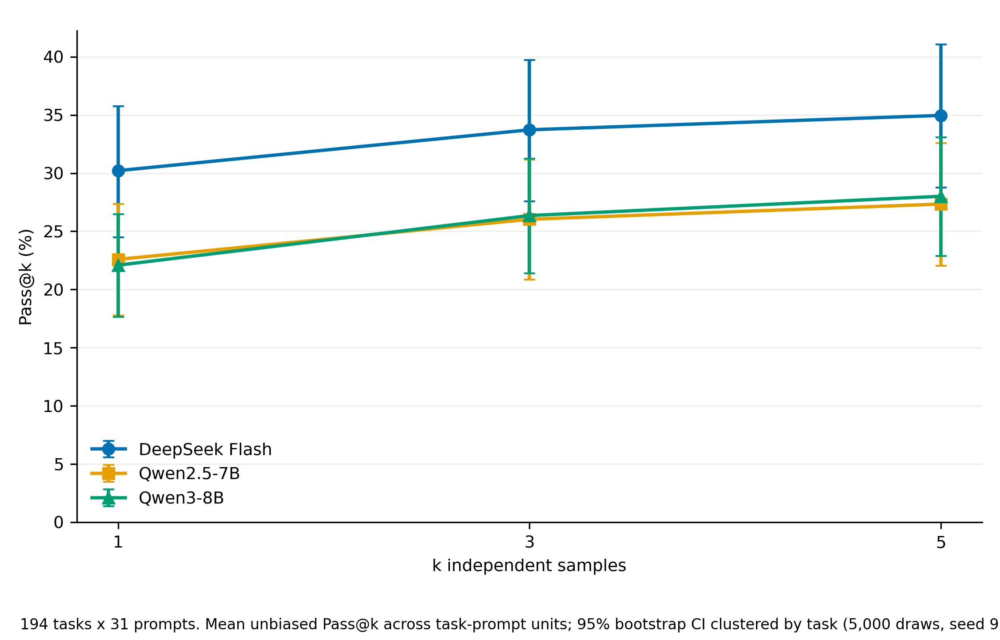
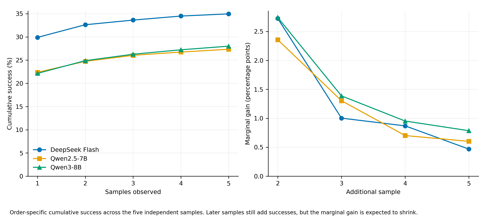
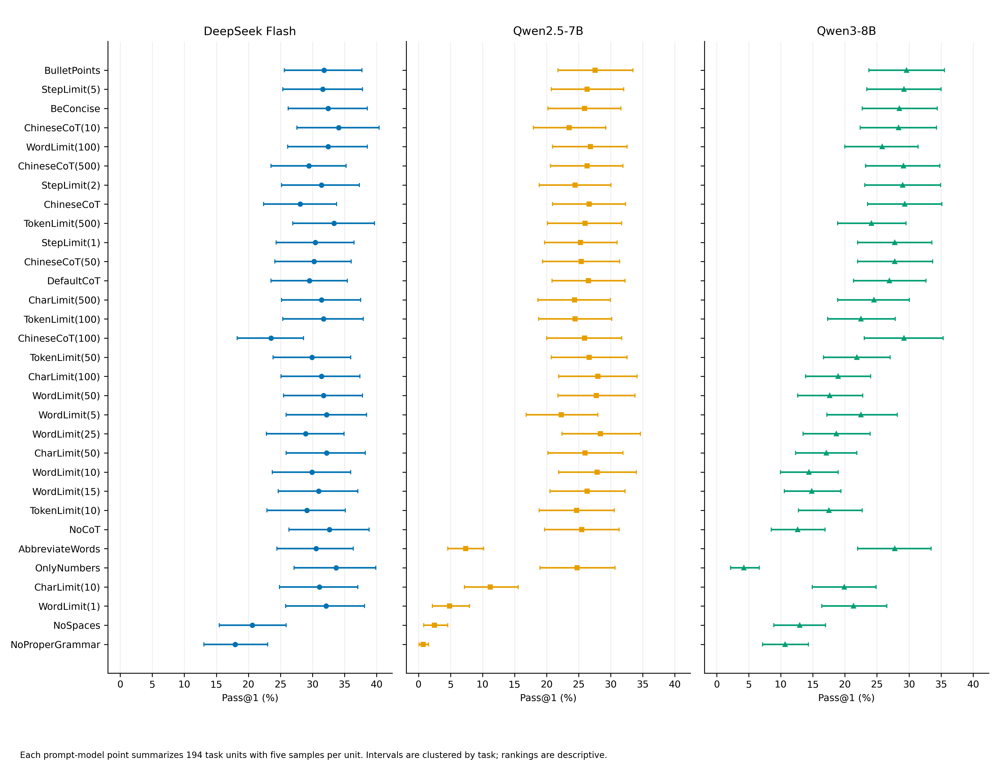
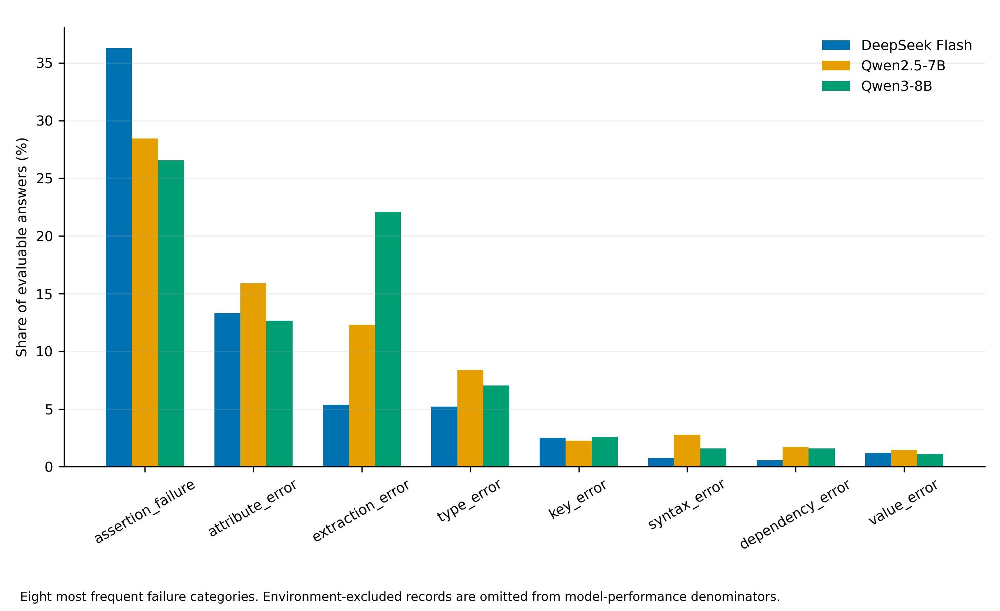
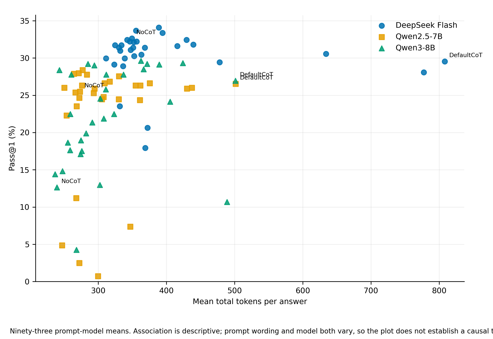

# 最终结果与结论

## 总体正确率与Pass@k

每个“模型 × 题目 × Prompt”单元包含5次相互独立的低温度采样。表中Pass@k采用标准无偏估计，并以 `task_id` 聚类bootstrap 5,000次计算95%置信区间。194道题中有1道题的参考实现无法稳定通过统一沙箱预检，因此三个模型都排除该题的155条记录；实际性能分母为193题、5,983个题目-Prompt单元。

| 模型 | 单样本成功率 / Pass@1 | Pass@3 | Pass@5 | 成功样本数 / 可评样本数 |
|---|---:|---:|---:|---:|
| DeepSeek Flash | 30.22% [24.50%, 35.74%] | 33.73% [27.57%, 39.71%] | 34.97% [28.75%, 41.07%] | 9,039 / 29,915 |
| Qwen2.5-7B-Instruct | 22.59% [17.78%, 27.33%] | 26.04% [20.84%, 31.19%] | 27.34% [22.03%, 32.58%] | 6,758 / 29,915 |
| Qwen3-8B | 22.09% [17.65%, 26.48%] | 26.36% [21.38%, 31.23%] | 28.01% [22.88%, 33.09%] | 6,609 / 29,915 |

配对比较显示，DeepSeek的Pass@1分别高于Qwen2.5和Qwen3约7.62、8.12个百分点，聚类bootstrap区间均不跨0；Pass@5优势分别约7.62、6.95个百分点。Qwen2.5与Qwen3在Pass@1/3/5上的差异区间均跨0，不能据此认为两者有稳定优劣。

## 重复采样的边际收益

这里的“第1—5轮”是同一条件下的5次独立调用，不是看到测试反馈后修复代码的多轮对话。累计成功率按定义不会下降，真正考察的是每增加一次调用还能新解决多少单元。

| 模型 | 1次累计 | 2次累计 | 3次累计 | 4次累计 | 5次累计 | 第5次边际提升 |
|---|---:|---:|---:|---:|---:|---:|
| DeepSeek Flash | 29.90% | 32.63% | 33.63% | 34.50% | 34.97% | +0.47个百分点 |
| Qwen2.5-7B-Instruct | 22.38% | 24.74% | 26.04% | 26.74% | 27.34% | +0.60个百分点 |
| Qwen3-8B | 22.15% | 24.89% | 26.27% | 27.23% | 28.01% | +0.79个百分点 |

三个模型的最大新增收益都出现在第2次采样，之后快速减小。DeepSeek和Qwen2.5有较强的饱和证据；Qwen3从第4次起点估计已低于1个百分点，但置信区间证据较弱。因此，5次调用能提高“至少有一次成功”的概率，但第4、5次的性价比明显低于第2次。

## Prompt差异

Prompt作用高度依赖模型，不能给出一个对三个模型都最优的统一策略：

- DeepSeek的Pass@1最高组包括 `ChineseCoT(10)` 34.09%、`OnlyNumbers` 33.68%、`TokenLimit(500)` 33.37%；`NoProperGrammar` 17.93%和`NoSpaces` 20.62%明显较低。
- Qwen2.5的最高组包括 `WordLimit(25)` 28.39%、`CharLimit(100)` 27.98%、`WordLimit(10)` 27.88%；`NoProperGrammar` 0.73%、`NoSpaces` 2.49%、`WordLimit(1)` 4.87%造成大量不可提取代码。
- Qwen3的最高组包括 `BulletPoints` 29.64%、`ChineseCoT` 29.33%、`ChineseCoT(100)`与`StepLimit(5)`均29.22%；`OnlyNumbers` 4.25%、`NoProperGrammar` 10.67%、`NoCoT` 12.64%最低。

`DefaultCoT` 相对 `NoCoT` 的配对Pass@1差异也不一致：DeepSeek为 -3.11个百分点 [−5.91, −0.41]，Qwen2.5为 +1.04个百分点 [−2.18, +4.25]，Qwen3为 +14.30个百分点 [+9.12, +19.79]。尤其Qwen3的 `NoCoT` 有43.8%的提取失败，因此这项差异同时反映推理指令和代码格式遵循能力，不能直接解释成“CoT本身提高推理能力”。

## 错误类型

在可评样本中，主要错误为：

| 模型 | 断言失败 | 属性错误 | 提取错误 | 类型错误 |
|---|---:|---:|---:|---:|
| DeepSeek Flash | 36.28% | 13.30% | 5.38% | 5.21% |
| Qwen2.5-7B-Instruct | 28.43% | 15.91% | 12.31% | 8.38% |
| Qwen3-8B | 26.56% | 12.64% | 22.08% | 7.03% |

断言失败表示代码能运行但结果不符测试，是最接近“逻辑错误”的类别。提取错误通常表示回答中没有可用函数代码；它在强格式压力Prompt中尤其常见。例如Qwen2.5的 `NoProperGrammar` 提取错误率为94.5%，Qwen3的 `OnlyNumbers` 为78.7%。因此“Prompt错误率”有实际意义：它不仅告诉我们答错多少，还能区分是逻辑错误、接口错误，还是Prompt把输出格式破坏了。

## 输出长度与正确率

不同Prompt下，平均token数和Pass@1没有简单的单调关系。图中的93个点同时改变了模型和Prompt，只能作为描述性观察，不能据此判断“输出越长越正确”或“越短越正确”。

## 可报告的核心结论

1. 在当前194题、31种Prompt、5次独立采样设置下，DeepSeek整体通过率高于两种Qwen模型；两种Qwen之间没有稳定差异。
2. Pass@3和Pass@5高于Pass@1，但边际收益快速饱和，第4、5次调用通常只增加不到1个百分点的累计成功率。
3. Prompt效果存在明显模型交互；同一个CoT或压缩策略在不同模型上可能提高、无明显变化或降低通过率。
4. 极端格式限制会显著提高代码提取失败率。比较Prompt时必须同时看通过率和错误类型，不能只看答案长度。
5. 这些结论限于本次可执行Python子集、低温度独立采样和当前云端模型版本，不代表所有代码任务。
