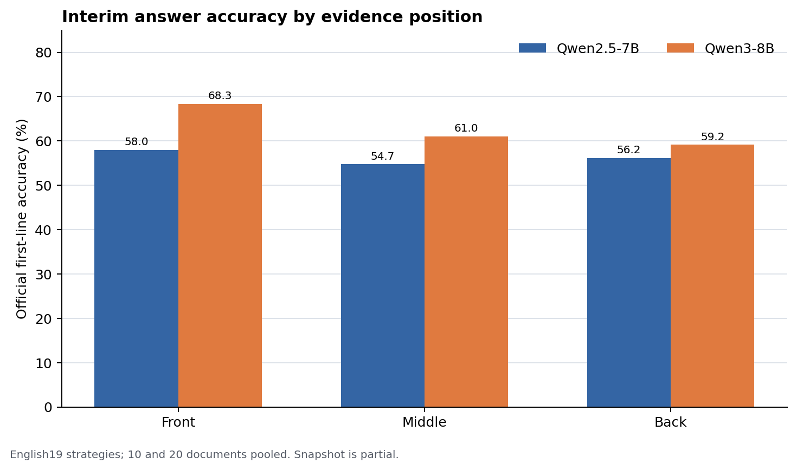
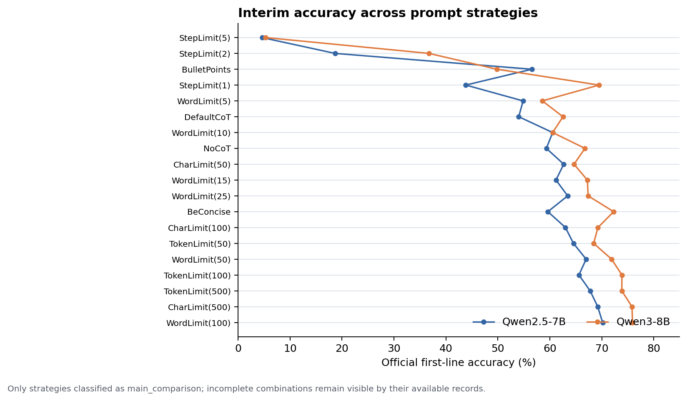
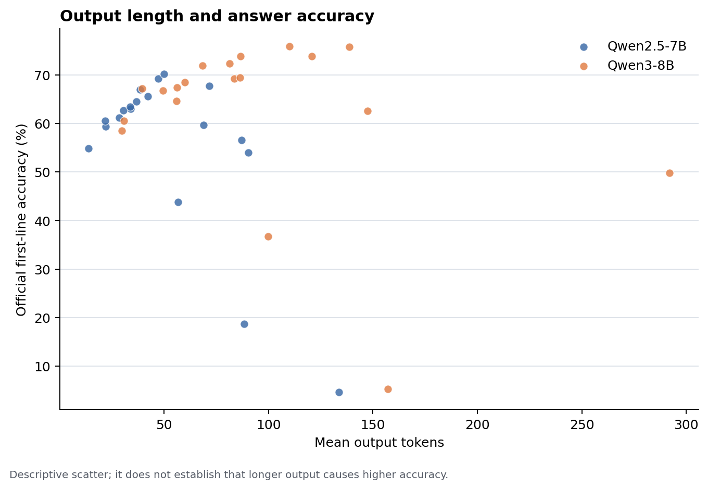

# 3. 阶段性结果、模型输出和图表

## 采集状态

截至快照时间 **2026-10-21 23:17:42（北京时间）**，原始日志有 38,912 条成功 API 响应：Qwen2.5 为 19,937 条，Qwen3 为 18,975 条；两个模型都覆盖 200 道基础题。另有 215 条无资料对照、566 条达到输出上限的截断响应和 786 条空 `FINAL ANSWER` 标记恢复记录。成功表示接口返回，不表示回答正确。

阶段性评分表在 [`derived/interim_analysis_20261021T231742.json`](../derived/interim_analysis_20261021T231742.json) 和 [`derived/interim_analysis_records_20261021T231742.csv`](../derived/interim_analysis_records_20261021T231742.csv)。

## 位置效应

使用论文官方口径：取模型回答首行，再用官方 `best_subspan_em` 做规范化答案包含匹配；位置比较固定 `question_id`、模型、策略和资料数量，并按题目聚类 bootstrap 计算探索性 95% 区间。19 个英文主比较策略合并 10/20 篇资料后：

| 模型 | 前 − 中 | 后 − 中 | 解释 |
|---|---:|---:|---|
| Qwen2.5-7B | +3.24 个百分点，CI [0.62, 5.95] | +1.78 个百分点，CI [-0.66, 4.31] | 前置优势较清楚，后置优势不稳定。 |
| Qwen3-8B | +8.51 个百分点，CI [5.79, 11.40] | −1.85 个百分点，CI [-4.11, 0.26] | 前置优势明显，当前没有后置优势证据。 |

所以当前可以支持“证据位置影响读取，放在开头通常更有利”的结论；还不能说两个模型都形成论文中的完整前后双峰 U 形曲线。论文和本实验的关系、统计限制和完整复现命令见 [`04-reproduction-and-limitations.md`](04-reproduction-and-limitations.md)。

## 可直接使用的图表







这些图都是阶段性快照；图脚本在 [`src/plot_results.py`](../src/plot_results.py)，可以对最终 JSON 重新生成。

## 模型输出示例

题目为 `sequel to a christmas story it runs in the family`，官方答案为 `My Summer Story`，条件是 20 篇资料、gold 位于中间。

Qwen2.5 的 `NoCoT` 输出：

```text
My Summer Story FINAL ANSWER:
```

Qwen2.5 的 `DefaultCoT` 能找到支持文段，最后输出：

```text
FINAL ANSWER: My Summer Story
```

Qwen3 的 `NoCoT` 输出：

```text
The sequel to *A Christmas Story* is *My Summer Story*. FINAL ANSWER: My Summer Story.
```

Qwen3 的 `DefaultCoT` 出现实体关系混淆：

```text
FINAL ANSWER: It Runs in the Family is a sequel to My Summer Story, which is a sequel to A Christmas Story.
```

这说明更长的解释不必然带来正确的最终答案。全部首题输出预览见 [`data/model_output_preview.txt`](../data/model_output_preview.txt)，逐条原始 API 响应见 [`data/raw_responses_20261021T231742+0800.jsonl`](../data/raw_responses_20261021T231742+0800.jsonl)。

## 异常和局限

Qwen3 的 `NoProperGrammar` 组出现 89/256 条截断，而 Qwen2.5 同组为 0/280；这可以作为 prompt 策略和模型交互的异常现象，但不能单凭截断数据推断机制。题目只有 200 道，31 个策略和位置变化是同题配对观测，不能把全部调用当成独立样本。中文、缩写、去空格和极短预算策略还需要专门评分规则。
